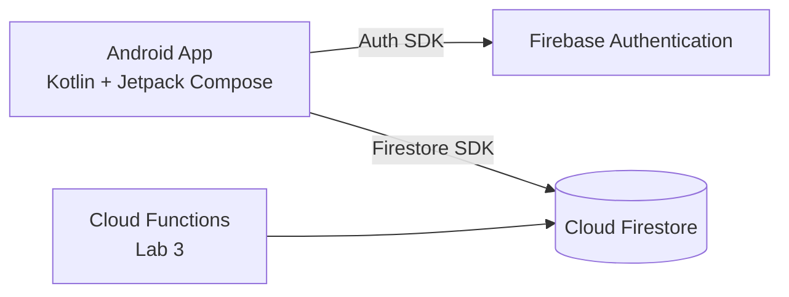

# RefScan — Lab 2

A mobile reference capture and management application designed for game artists and level designers away from their desktop workstations.

---

## Problem Statement
> *"Game artists and level designers walking outside or traveling cannot use desktop task managers to instantly capture, tag, and organize real-world material textures and color references for their active game projects."*

---

## Team & Roles (60 / 40 Workload Distribution)

- **Fateh Hasanli** (Student ID: 57322 | Email: `fatehqasanov@gmail.com`) — **Product Owner & Tech Lead: Architecture, Data Layer, Auth & Form Logic**
- **Ibrokhimov Odiljon** (Student ID: 52857 | Email: `52857@student.polsl.pl`) — **40% Workload** (QA / DevOps & Developer: Live List UI, Security Rules, Extensions & Board)

---

## Tech Stack Table

| Component | Technology / Library |
| :--- | :--- |
| **App Framework** | Kotlin + Jetpack Compose |
| **Backend & Auth** | Firebase Authentication |
| **Cloud Database** | Cloud Firestore (EU Region - `europe-west1`) |
| **Security** | Firestore Security Rules (`firestore.rules`) |
| **Testing** | JUnit 4, Kotlin Coroutines Test Framework |

---

## Definition of Done (DoD)

> *"A story is done when it is merged to main through a reviewed PR with at least one approval, works on the device of both team members (Fateh Hasanlı and Ibrokhimov Odiljon), does not crash on invalid input or screen rotation, and its linked GitHub issue is closed."*

---

## Cloud Data Model (R2 & R3)

**Main Collection:** `references`  
**Reference Collection (Read-Only):** `projects`

| Collection | Field Name | Type | Set By | Description |
| :--- | :--- | :--- | :--- | :--- |
| `users` | `uid` | String (doc id) | Firebase Auth | User account identifier |
| `users` | `email` | String | User / Auth | e.g. `fatehqasanov@gmail.com` |
| `projects` | `id` | String (doc id) | Admin / Seed | e.g. `proj_1` (Reference collection) |
| `projects` | `title` | String | Admin / Seed | e.g. `Cyberpunk Alley Level` |
| `references` | `id` | String (doc id) | Firestore | Unique reference ID |
| `references` | `ownerId` | String | App (Auth session) | Foreign key to `users.uid` |
| `references` | `projectId` | String | User Input | Foreign key to `projects.id` |
| `references` | `note` | String | User Input | Material reference description |
| `references` | `colorHex` | String | User Input | Surface color hex code (`#RRGGBB`) |
| `references` | `rating` | Int | User Input | Importance rating (1 to 5 stars) |
| `references` | `status` | String | User Input | `"active"` or `"archived"` |
| `references` | `createdAt` | Timestamp | Server Clock | `FieldValue.serverTimestamp()` |
| `references` | `updatedAt` | Timestamp | Server Clock | `FieldValue.serverTimestamp()` |

---

## Architecture Diagram (Mermaid)

---

## Implemented Extensions (R9 - 4 Completed)

- **E1: Search** — Text field filters the list by `note` and `projectName` (case-insensitive) with clear button.
- **E3: Empty & No-Results States** — Distinct hint for empty list vs. no search hits.
- **E5: Status Toggle & Filtering** — Toggle chips filter list between "All", "Active", and "Archived".
- **E7: Statistics Header** — Header card displays live computed metrics (`"2 active · 1 archived"`).

---

## Server-Side Access Control (R8)

Security rules defined in [`firestore.rules`](firestore.rules) and tested against 8 key scenarios:

| # | Scenario Description | Expected | Result |
| :-: | :--- | :-: | :-: |
| **1** | Read own record | Allowed | ✅ **ALLOWED** |
| **2** | Read same record as a different user | Denied | ✅ **DENIED** |
| **3** | Read without being signed in | Denied | ✅ **DENIED** |
| **4** | Create record whose `ownerId` is another user | Denied | ✅ **DENIED** |
| **5** | Create record breaking logical rule | Denied | ✅ **DENIED** |
| **6** | Update own record, changing its `ownerId` | Denied | ✅ **DENIED** |
| **7** | Create record in reference collection (`projects`) | Denied | ✅ **DENIED** |
| **8** | Read reference record as signed-in user | Allowed | ✅ **ALLOWED** |

---

## Lab 2 Reports & Tag
- Final Report Document: [`Lab2_Final_Report.md`](Lab2_Final_Report.md)
- Printable PDF Report: [`Lab2_Final_Report.pdf`](Lab2_Final_Report.pdf)
- Release Tag: `lab2`
