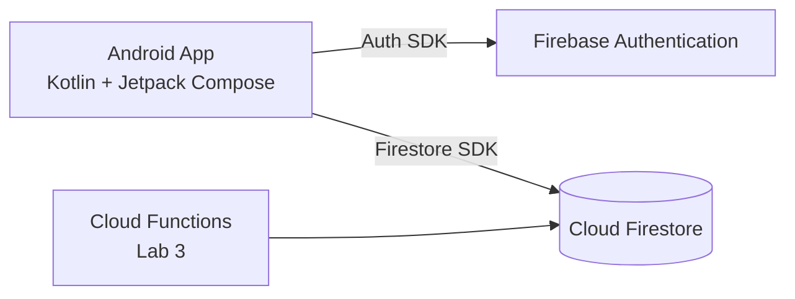

# RefScan

A mobile reference capture and management application designed for game artists and level designers away from their desktop workstations.

---

## Problem Statement
> *"Game artists and level designers walking outside or traveling cannot use desktop task managers to instantly capture, tag, and organize real-world material textures and color references for their active game projects."*

---

## Team & Roles
This project is developed as a solo-developer project for **Mobile Application in the Cloud — Lab 1**:

- **Developer:** Fateh Hasanlı (Student ID: 57322)
- **Account Email:** fatehqasanov@gmail.com
- **Roles:** Product Owner (PO), Tech Lead, Developer, QA / DevOps

---

## MVP Features

- **User Authentication (Sprint 1 - Complete):** Register, Log In, Log Out, and Auto-Login session persistence using Firebase Authentication.
- **Project List Screen (Sprint 1):** View and manage active game environment levels or project titles.
- **Reference Detail & Edit Screen (Sprint 1):** View, add, and update real-world notes, surface material tags, and color hex codes linked to a project.
- **Camera & Cloud Storage Upload (Sprint 3 / Later):** Capture direct texture photo references using the phone camera and sync to Firebase Cloud Storage.

---

## Cloud Data Model (Cloud Firestore)

```
[users] (Collection)
 └── uid (Doc ID - String matching Firebase Auth UID)
      ├── email: String (e.g. fatehqasanov@gmail.com)
      ├── displayName: String
      └── createdAt: Timestamp

[projects] (Collection)
 └── projectId (Doc ID - String)
      ├── ownerId: String (foreign key -> users.uid)
      ├── title: String (e.g. "Cyberpunk Alley Level")
      ├── engine: String (e.g. "Unreal Engine 5")
      └── createdAt: Timestamp

[references] (Collection)
 └── referenceId (Doc ID - String)
      ├── projectId: String (foreign key -> projects.projectId)
      ├── ownerId: String (foreign key -> users.uid)
      ├── note: String (e.g. "Wet asphalt roughness & puddle reflection")
      ├── colorHex: String (e.g. "#1A2B3C")
      └── createdAt: Timestamp
```

---

## Architecture Diagram

GitHub renders Mermaid diagrams directly in Markdown:



### Layered Code Structure (3-Layer Architecture)
- **Data Layer:** `AuthRepository` (interface) and `FirebaseAuthRepository` (implementation using `Firebase.auth`, `await()`, `callbackFlow`).
- **Logic Layer:** `AuthValidator` (pure Kotlin input rules) and `AuthViewModel` (UI state handling via `StateFlow` and error mapping).
- **UI Layer:** `LoginScreen`, `RegisterScreen`, `HomeScreen`, and `AppNavHost` (Jetpack Compose with reactive Navigation).

---

## How to Run

1. Clone this repository:
   ```bash
   git clone https://github.com/fatehqasanov/refsacn.git
   ```
2. Open the project in **Android Studio** (Ladybug / 2024+).
3. Ensure `google-services.json` is located inside the `app/` directory.
4. Let Gradle sync dependencies automatically.
5. Select an Android Emulator (API 26+) or physical device and click **Run** (`Shift + F10`).

---

## Lab 1 Deliverables
- Final Report Document: [`Lab1_Final_Report.md`](Lab1_Final_Report.md)
- Printable PDF Report: [`Lab1_Final_Report.pdf`](Lab1_Final_Report.pdf)
